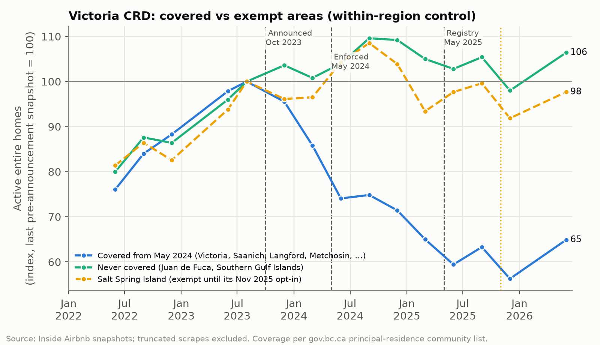

# Did BC's short-term rental ban work? Evidence from Bill 35, 2022-2026

**[Open the interactive dashboard →](https://haji5.github.io/bc-str-ban-analysis/)**

An end-to-end causal evaluation of British Columbia's *Short-Term Rental Accommodations Act* (Bill 35). The Act restricted short-term rentals to the host's principal residence from May 2024 and added a provincial registry with platform de-listing from May 2025. The project:

- assembles 52 Inside Airbnb snapshots, 40 of them recovered from unlisted archives;
- joins them to Statistics Canada, Bank of Canada and CMHC housing data in a DuckDB SQL layer;
- estimates difference-in-differences and event-study models with cluster-robust, wild-bootstrap and randomization inference;
- presents the results in an interactive web dashboard, a Streamlit app for live re-estimation, and a two-page policy brief.

**Stack:** Python · DuckDB/SQL · pyfixest · statsmodels · pandas · matplotlib · Plotly · D3.js · Streamlit · pytest
**Data:** Inside Airbnb listings through June 2026 (retrieved October 2026); StatCan CPI Table 18-10-0004-01; Bank of Canada policy rate; CMHC Rental Market Survey.

## Headline findings

1. **Supply fell where Bill 35 changed the rules.** In the Victoria Capital Regional District (CRD), active entire-home listings in areas covered by the principal-residence requirement fell **35%** (3,133 → 2,033, Aug 2023 → Jun 2026). The never-covered areas (Juan de Fuca, Southern Gulf Islands) rose 6%. Against the exempt areas, listings fell **32%** at Phase 1 (May 2024). Randomization inference gives p = 0.011 for Phase 1, against all 3,654 possible three-area control groups. The further **11%** decline at Phase 2 (registry, May 2025) cannot be told apart from placebo assignments (p = 0.27).
2. **Vancouver, which already had a 2018 bylaw, did not shrink.** Entire-home listings dipped 22% at the June 2025 registry deadline. By June 2026 they were 5% above September 2023, and 9% above June 2023 on a like-for-like season basis. That endpoint rests on one snapshot in which 19% of listings are IDs never seen before, against 9-13% in every complete snapshot since March 2024.
3. **The standard room-type comparison understates the effect.** Private rooms look like a natural control, but they are partly treated: the Phase-2 registry covers every short-term rental, and covered-area private rooms in Victoria fell 25%. That design gives −13% (OLS, p = 0.06) or −16% (Poisson, p = 0.003) for Phase 1. Its pre-trends pass a joint test on five pre-announcement leads (p = 0.23).
4. **No detectable rent relief.** CPI rented accommodation rose 19.5% in Victoria, 11.5% in Vancouver and 20.6% in Ottawa from Sep 2023 to Jun 2026. From a June 2023 base the figures are 19.2%, 14.4% and 15.4%, so the ranking depends on the base month. Victoria's lost listings equal about 1.7% of renter households, which caps any rent effect at −0.4% to −3.3%. That is below the noise in the CPI series.



| KPI (active listings unless stated) | Pre (Aug/Sep 2023) | Jun 2026 | Change |
|---|---:|---:|---:|
| Victoria CRD entire homes, covered areas | 3,133 | 2,033 | **−35.1%** |
| Victoria CRD entire homes, never-covered areas (Juan de Fuca, Southern Gulf Islands) | 500 | 532 | +6.4% |
| Salt Spring Island entire homes (exempt until its Nov 2025 opt-in) | 258 | 252 | −2.3% |
| Victoria CRD private rooms, covered areas | 468 | 352 | −24.8% |
| Vancouver entire homes | 4,795 | 5,032 | +4.9% |
| Vancouver private rooms | 1,075 | 1,100 | +2.3% |
| Multi-listing-host share, Victoria entire homes | 46.1% | 37.6% | −8.5 pp |
| Entire homes showing a provincial registration number, Vancouver / Victoria | 0% | 73% / 70% | a further 6% / 9% show "Exempt" |
| CPI rented accommodation: Victoria / Vancouver / Ottawa (Sep 2023 = 100) | 100 | 119.5 / 111.5 / 120.6 | none attributable |

| Causal estimate (real data) | Phase 1 (May 2024) | Phase 2, incremental (May 2025) | Pre-trend |
|---|---:|---:|---|
| **Victoria covered vs exempt** (preferred; 3 control areas) | **−0.390** (0.054), RI p = 0.011 | −0.115 (0.045), RI p = 0.27 | 4 leads: p = 0.29 (Wald), 0.92 (RI); anticipation −0.124 (0.034) |
| … never-covered controls only (2 areas) | −0.404 (0.057), RI p = 0.040 | −0.115 (0.055), RI p = 0.37 | |
| … reviewed-in-180-days outcome | −0.502 (0.085) | −0.174 (0.060) | |
| Victoria triple difference (room × coverage × post) | −0.326 (0.130) | −0.274 (0.241) | |
| Room-type DiD, BC, OLS log(1+n) | −0.138 (0.071) | +0.073 (0.043) | 5 leads: p = 0.23 |
| Room-type DiD, BC, PPML | −0.179 (0.061) | +0.049 (0.051) | |
| Cross-market BC vs Ottawa | −0.212 (0.046) | −0.058 (0.032) | **fails** (one lead in window, +0.12, p = 0.001); not used for inference |

Coefficients are log points. Neighbourhood-clustered standard errors are in parentheses. With only three control areas, clustered p-values overstate precision: on the synthetic panel, the clustered pre-trend test rejects at p = 0.01 even though parallel trends hold by construction. The preferred design therefore uses placebo-in-space randomization inference (RI). Every set of three of the 29 Victoria neighbourhoods is relabelled as the control group, and the p-value is the share of placebo estimates at least as large as the real one. Wild-cluster bootstrap p-values (0.050 for Phase 1, 0.093 for Phase 2) are in the results file but are unreliable with this few controls. `make model` writes the full regression table to `data/processed/regression_table.csv`.


The rent comparison (STR supply vs CPI rent, policy rate and CMHC vacancy) is in [`assets/fig3_rent_transmission.png`](assets/fig3_rent_transmission.png).

**Policy brief.** [`memo/bc_str_policy_memo.md`](memo/bc_str_policy_memo.md) presents the findings and recommendations as a two-page briefing note addressed to a Deputy Minister. It is an independent analysis, written in that format as a communication exercise; it was not commissioned by or prepared for the Government of British Columbia.

## Design decisions: where the textbook design broke on real data

The usual design for this question is a within-market difference-in-differences: entire homes vs private rooms, monthly city panels, Ottawa and Seattle as outside controls. Each piece was tested against the data before modelling, and several did not survive.

| Textbook choice | What the data showed | What this project does instead |
|---|---|---|
| Download the Inside Airbnb archive for 2022-2026 | The site lists only the trailing 12 months (Dec 2025-Sep 2026), all after the policy. That alone cannot identify anything | Older files still exist on Inside Airbnb's server. A limited search found 40 unlisted snapshots back to Jun 2022, listed in `data/fixtures/known_archive_snapshots.json` |
| City × room-type × month panel | 2 BC cities × 2 room types = **4 clusters**, too few for cluster-robust standard errors | Estimation runs at neighbourhood × room type (49 BC clusters). City-level tables are kept for reporting |
| Private rooms as an untreated control | The Phase-2 registry covers every listing, and covered-area private rooms in Victoria fell 25%. Renting rooms in one's own home stays legal, so how far Phase 1 reached private rooms is unclear | The room-type DiD is reported as a **lower bound**. The **exempt-area design** is the preferred within-BC control, with a triple difference alongside |
| "Exempt" = municipalities under 10,000 people | A small municipality is exempt only if it is more than 15 km from a larger one. Metchosin and Highlands are covered, and Salt Spring Island opted in from Nov 2025 | Controls are Juan de Fuca and the Southern Gulf Islands, plus Salt Spring Island until its opt-in (`src/config.py`). A variant uses the two never-covered areas only |
| Cluster-robust inference | Three control clusters: clustered tests over-reject, and the wild bootstrap is unreliable | Placebo-in-space randomization inference over every three-area control group (3,654), for the effects and for the pre-trend test |
| Normalise the event study to t = −1 | t = −1 (Apr 2024) is six months after the Oct 2023 announcement, so anticipation would contaminate the baseline | Reference is the last pre-announcement snapshot (**Sep 2023**, t = −8). Live leads are never pooled into an endpoint bin, so every pre-announcement snapshot gets its own coefficient (4-5 leads per test). A separate anticipation term enters the static DiD |
| Ottawa + Seattle as outside controls | Ottawa fails pre-trends (BC out-grew it in mid-2023). Seattle has no public archive before 2025 | Cross-market results are reported with pre-trend diagnostics but not relied on. A control city needs ≥ 2 pre-announcement snapshots in the window |
| Monthly panel | Real snapshots are roughly quarterly. Four are truncated (the Mar 2026 Victoria, Ottawa and Seattle files and Vancouver Mar 2025), unevenly across neighbourhoods; one estimate was inflated 3× before this was caught | Months without a snapshot are marked unobserved, never interpolated. Real-data event studies use one bin per snapshot quarter. Snapshots with fewer than 75% of their neighbours' listings are flagged and excluded. Each snapshot also records its share of never-seen listing IDs |
| Registry compliance from the licence field | From 2025 the field reads "Provincial registration number: …", and 6-9% of listings show "Exempt" there | Only a registry number (H/PM/ST + digits) counts as registered. Exemption claims are reported separately |
| CPI rent as the outcome | StatCan publishes only the "Rented accommodation" aggregate for metro areas. It tracks sitting tenants under BC's rent-increase cap | Used as the rent proxy, with a level DiD as the primary spec. In y/y growth a one-off level shift shows up mechanically as −x, then +x exactly when the Phase-2 dummy switches on |
| Dual-axis rent chart | Two y-scales let the chart-maker choose the apparent correlation | Fig 3 indexes STR supply and rents to a common base (Sep 2023 = 100) on one axis |
| Synthetic fallback data | Estimates on simulated data are not findings | Synthetic data is a **separate data source**. It is never mixed into real-data estimates and never regressed against real rents; it serves as a parameter-recovery test with known truth |

## Method

**Data layer.** `src/ingest.py` finds published snapshots, adds the known archive list and any manually added files, then downloads `listings.csv.gz` with retries and backoff. It fetches StatCan Table 18-10-0004-01 and the Bank of Canada policy rate from their APIs, and loads curated CMHC benchmarks. Each source falls back to a committed fixture on failure, and a manifest records which path each one took.

**SQL layer** (`queries/`, DuckDB; policy dates injected as session variables):

- `01_clean_listings.sql`: parse `$1,234.00` prices (winsorised to $10-$10,000); deduplicate re-scraped rows; flag active listings (reviewed in the last 180 days or bookable); map room types; flag multi-listing hosts, licence numbers, provincial registry numbers (separately from "Exempt" claims) and principal-residence exemption with its opt-in date.
- `02_aggregate_monthly.sql`: scrape-completeness flags and the share of never-seen listing IDs per snapshot; neighbourhood- and city-level monthly aggregates (active count, median price, availability, multi-listing share, registration shares), with zero-filled empty cells.
- `03_build_panel.sql`: complete Jan 2022-Jun 2026 panels (`str_rent_panel`, `str_nbhd_panel`) with policy indicators, exemption status by month, CPI (levels, y/y, real), policy rate, and CMHC data as of each survey's publication.

**Models** (`src/models.py`, pyfixest + statsmodels). Each runs on both real and synthetic data:

| Spec | Model |
|---|---|
| S1 | `log(1+active) ~ Entire×{Antic, Post2024, Post2025} \| unit + city×month`, clustered by neighbourhood. Variants: per city, Poisson (PPML), reviewed-in-180-days outcome, room × calendar-month FE |
| S2a | Victoria covered vs exempt entire homes (unit + month FE), with randomization inference and wild-cluster bootstrap. Variants: never-covered controls only, reviewed-in-180-days outcome, PPML |
| S2-ES / S2b | Event study for the exempt-area design (Wald and randomization-inference pre-trend tests); triple difference |
| S3 | Event study t ∈ [−12, 24], reference t = −8. Synthetic: monthly, binned endpoints. Real: one bin per snapshot quarter, leads never pooled. Joint pre-announcement Wald test |
| S4 | Cross-market event study and DiD, with leave-one-control-out and wild bootstrap |
| S5 | Rent: level and y/y DiD of CPI rented accommodation, BC vs Ottawa (Driscoll-Kraay SEs; descriptive with three cities); association with observed STR counts; mechanical bound |

**Synthetic validation.** `src/synthetic.py` generates listing-level data in Inside Airbnb's format, calibrated to the real snapshots. It deliberately includes the real data's problems: duplicates, missing prices, dormant listings, scrape-coverage shocks, a partly treated control, commercial-host exits, and Salt Spring Island's opt-in (so S2a recovers the truth only if post-opt-in cells leave the control group). The estimators recover the known truth:

| Synthetic check | Estimate (SE) | Truth |
|---|---:|---:|
| S1 room-type, Phase 1 | −0.087 (0.022) | −0.093 |
| S1 PPML, Phase 1 | −0.084 (0.014) | −0.093 |
| S2a exempt-area, Phase 1 / Phase 2 | −0.261 (0.031) / −0.165 (0.022) | −0.260 / −0.150 |
| S4b cross-market, Phase 1 | −0.168 (0.025) | −0.166 |

This checks the estimators, not the identification. The simulated data have parallel trends and use the same exempt list as the analysis, so they cannot catch a misclassified control group. That error was found by checking the list against the regulation (see Corrections).

**Tests.** `tests/test_pipeline.py` (31 tests) covers:

- an SQL unit test on hand-written edge cases (including a provincial "Exempt" claim);
- no NULL or duplicate primary keys;
- complete monthly panels with no gaps;
- policy-flag consistency and CPI join coverage;
- offline fixtures and deterministic synthetic generation;
- finite coefficients with positive standard errors;
- parameter recovery within 3 SE;
- event-study window shape and pre-trends;
- design guards: the exempt schedule matches the regulation, opted-in areas leave the control group, live pre-trend tests use every pre-announcement snapshot, and randomization inference is reported;
- the committed dashboard bundle (opens read-only with every table the app queries).

## Reproduce

```bash
make install        # venv + dependencies (Python 3.10-3.13)
make all            # data -> sql -> model (+figures) -> test; real data with automatic fallback
make all OFFLINE=1  # no network: committed fixtures + synthetic panel only
make app            # Streamlit app (local, live re-estimation)
make app-data       # refresh the dashboard's committed data bundle (data/app/)
```

Without GNU make (e.g. on Windows), `python run.py all` runs the same steps, and `python run.py all --offline` is the offline version. Individual targets are `data`, `sql`, `model`, `plots`, `test` and `app`.

A full run downloads about 135 MB (Inside Airbnb listings files only, plus StatCan and Bank of Canada). Once downloads finish, the build takes seconds and estimation about a minute and a half (the randomization inference and 9,999-draw wild bootstraps dominate). Results are identical across rebuilds up to floating-point tolerance.

**Dashboard** ([open](https://haji5.github.io/bc-str-ban-analysis/)). An interactive D3 dashboard in six sections:

- **Verdict:** headline effects, Victoria covered-vs-exempt trajectories, the three designs side by side, and CPI rents;
- **Supply:** listing trajectories for all four markets (indexed or counts), multi-listing-host exit and registry uptake;
- **Neighbourhoods:** change by neighbourhood, with a sortable, searchable table and trend sparklines;
- **Causal estimates:** event studies with pre-trend tests, every specification in one forest plot, and a real/synthetic toggle that shows the pipeline recovering a known truth;
- **Rents:** CPI rent paths, the mechanical bound on rent effects set against CPI noise, and the rent models;
- **Data & method:** snapshot coverage, identification strategies, pipeline and threats.

Every figure on it is traceable: clicking a number shows the dataset or formula behind it. Its data are exported from the committed bundle in `data/app/` and `data/processed/regression_table.csv`.

**Streamlit app** (`app/app.py`, run locally with `make app`). The analyst's workbench:

- city and room-type filters;
- an adjustable event-study window;
- regressions re-estimated live;
- a data-provenance tab.

The app never builds data itself. If `make all` has produced the full database, it reads that. Otherwise it reads a 2 MB bundle committed in `data/app/`, which holds the panel tables and model results. After re-running the pipeline, refresh the bundle with `make app-data`.

## Limitations

- **Snapshots are quarterly**, and some 2024 quarters are missing for some cities. Monthly dynamics come only from the synthetic panel.
- **Three control areas.** The preferred design rests on Juan de Fuca, the Southern Gulf Islands and (until Nov 2025) Salt Spring Island: rural areas next to an urban treated group. Pre-trends match (4 leads, RI p = 0.92), but randomization inference can only reach precision that so few controls allow, and the Phase-2 effect is not distinguishable from placebo assignments.
- **"Active" relies on reviews and availability.** The share of listings with any open calendar rises to 95-100% in some 2025-26 files (Ottawa from Mar 2024), so levels shift across vintages. Month fixed effects absorb this when the shift is common to treated and control areas. The stricter reviewed-in-180-days outcome gives a larger Victoria effect (−39% at Phase 1).
- **Vintage changes.** In the June 2026 files, total listings jump against December 2025 in every market except Ottawa (Seattle +21%, Victoria +23%, Vancouver +14%), and 19% of Vancouver's listings are never-seen IDs. Treat single-snapshot endpoints, such as Vancouver's June 2026 level, with care.
- **Prices are not comparable across vintages.** Inside Airbnb changed its price fields in 2026 (the Dec 2025 Vancouver and Victoria files carry no prices), so prices are reported but not modelled causally.
- **Rents.** Three metro-level CPI series with ±3-5 point quarterly noise cannot detect a 1-3% effect. With three cities, Driscoll-Kraay p-values are not credible: the level DiD shows BC rents rising faster than Ottawa's (+4.9 and +2.8 log points), which is not evidence either way. Asking-rent data and tracking of delisted units would be needed (see the brief).
- **Data provenance.** CMHC values are curated by hand, with a quality flag per row (`data/fixtures/README.md`). Vancouver 2022 and 2024-25, Victoria 2024-25 and Ottawa 2023-24 are confirmed against CMHC releases or reports citing them. Five 2022-23 and 2025 values are still marked `unverified`. Renter-household counts in the rent bound are approximate 2021 Census figures.
- **Exempt-area status** follows the gov.bc.ca principal-residence community list (checked Oct 2026) and Salt Spring Island's opt-in. Later opt-ins or opt-outs need a date in `src/config.py`.

## Corrections (October 2026 audit)

An independent review of this repository found errors that changed reported numbers. All are fixed above and guarded by tests.

1. **Misclassified control areas.** Metchosin and Highlands were treated as exempt, but the principal-residence requirement covers them under the 15 km rule. Salt Spring Island's November 2025 opt-in was ignored. Correcting both raised the Phase-1 estimate from −27% to −32% and cut Phase 2 from −15% to −11%. The reported wild-bootstrap p-values (0.007 and 0.04) did not survive. Randomization inference gives 0.011 and 0.27.
2. **Registration rate.** "Provincial registration number: Exempt" was counted as a registration. The share with a registry number is 73% (Vancouver) and 70% (Victoria), not 79%.
3. **Pre-trend tests.** The "joint" tests pooled all of 2022 to mid-2023 into one coefficient. Each snapshot now has its own lead (4-5 per test), and the conclusions are unchanged. The preferred design also gained an event study and its own pre-trend test.
4. **Brief.** The rent-on-STR association had its sign reversed. The BC-vs-Ottawa rent differences are all positive (they were described as "unstable in sign"). The triple difference is now reported.
5. **CMHC data.** Ottawa's 2024 vacancy was 2.6%, not 2.9% (2.9% was the 2023 downtown rate). Victoria's 2025 rate was 3.3%, not 3.2%. Each survey now enters only from its publication.
6. **Counts and wording.** There are 40 archived and 12 published snapshots (not 36 and 16), and Vancouver's March 2026 file is complete.
7. **Reproducibility.** Wild-bootstrap p-values shifted with row order across database rebuilds. The panel is now sorted and the bootstrap uses 9,999 draws.

## Repository layout

```
Makefile, run.py         task runner (make / cross-platform)
src/config.py            policy calendar, markets, exempt areas, endpoints
src/ingest.py            downloads, fallback, manifest
src/synthetic.py         calibrated synthetic panel with known truth
src/database.py          DuckDB build; executes queries/*.sql
src/models.py            S1-S5 specifications
src/plots.py             figures in assets/
queries/01-03_*.sql      SQL transformation layer
app/app.py               Streamlit app (local, live re-estimation)
tests/test_pipeline.py   pytest suite
data/fixtures/           offline fixtures (provenance in data/fixtures/README.md)
data/app/                committed dashboard data (panel tables + model results)
memo/                    two-page policy brief
```

**Data sources and licences:** Inside Airbnb (CC BY 4.0), Statistics Canada (Open Government Licence - Canada), Bank of Canada, CMHC.
