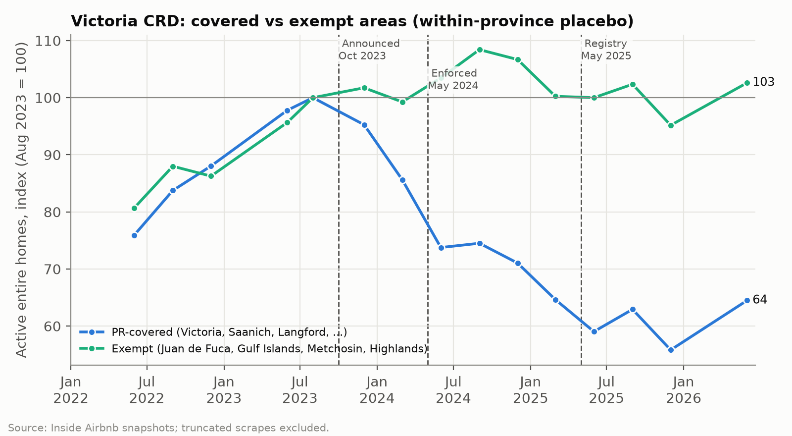
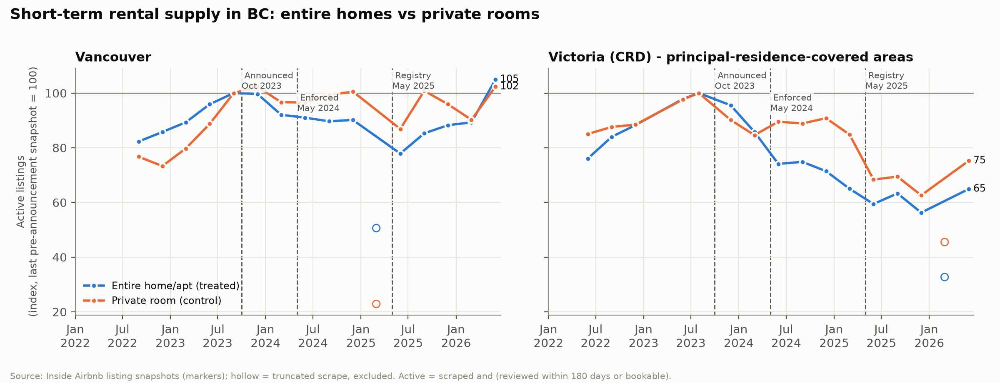
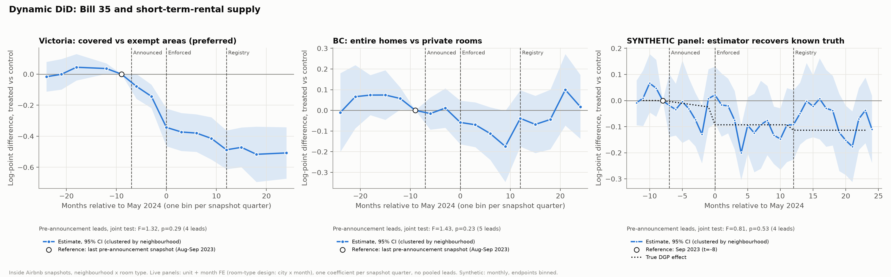

# Did BC's short-term rental ban work? Evidence from Bill 35, 2022-2026

**[Open the live dashboard →](https://bc-str-ban-analysis.streamlit.app/)**

An end-to-end causal evaluation of British Columbia's *Short-Term Rental Accommodations Act* (Bill 35). The Act restricted short-term rentals to the host's principal residence from May 2024 and added a provincial registry with platform de-listing from May 2025. The project:

- assembles 52 Inside Airbnb snapshots, 36 of them recovered from unlisted archives;
- joins them to Statistics Canada, Bank of Canada and CMHC housing data in a DuckDB SQL layer;
- estimates difference-in-differences and event-study models with cluster-robust and wild-bootstrap inference;
- presents the results in a Streamlit dashboard and a two-page policy brief.

**Stack:** Python · DuckDB/SQL · pyfixest · statsmodels · pandas · matplotlib · Plotly · Streamlit · pytest
**Data:** Inside Airbnb listings through June 2026 (retrieved October 2026); StatCan CPI Table 18-10-0004-01; Bank of Canada policy rate; CMHC Rental Market Survey.

## Headline findings

1. **Supply fell where Bill 35 changed the rules.** In the Victoria Capital Regional District (CRD), active entire-home listings in areas covered by the principal-residence requirement fell **36%**. Exempt rural areas in the same region stayed flat. Against that within-region control, listings fell **27%** at Phase 1 (May 2024) and a further **15%** at Phase 2 (registry, May 2025); wild-bootstrap p = 0.007 and 0.04.
2. **Vancouver, which already had a 2018 bylaw, did not shrink.** Entire-home listings dipped 22% at the June 2025 registry deadline and were back **5% above** their pre-announcement level by June 2026.
3. **The standard room-type comparison understates the effect.** Private rooms look like a natural control, but they are partly treated: the registry covers every short-term rental, and 74% of private-room listings are run by multi-listing hosts. That design gives −13% (OLS, p = 0.07) or −16% (Poisson, p = 0.003) for Phase 1, with clean pre-trends (p = 0.25).
4. **No detectable rent relief.** CPI rented accommodation rose 19.5% in Victoria, 11.5% in Vancouver and 20.6% in Ottawa (Sep 2023 → Jun 2026). Victoria's lost listings equal about 1.7% of renter households, which caps any rent effect at −0.4% to −3.3%. That is below the noise in the CPI series.



| KPI (active listings, principal-residence-covered areas) | Pre (Aug/Sep 2023) | Jun 2026 | Change |
|---|---:|---:|---:|
| Victoria CRD entire homes, covered areas | 3,083 | 1,988 | **−35.5%** |
| Victoria CRD entire homes, exempt areas | 808 | 829 | +2.6% |
| Victoria CRD private rooms, covered areas | 459 | 345 | −24.8% |
| Vancouver entire homes | 4,795 | 5,032 | +4.9% |
| Vancouver private rooms | 1,075 | 1,100 | +2.3% |
| Multi-listing-host share, Victoria entire homes | 46.1% | 37.6% | −8.5 pp |
| BC entire homes showing a provincial registration number | 0% | 79% | +79 pp |
| CPI rented accommodation: Victoria / Vancouver / Ottawa | 100 | 119.5 / 111.5 / 120.6 | none attributable |

| Causal estimate (real data) | Phase 1 (May 2024) | Phase 2, incremental (May 2025) | Pre-trend |
|---|---:|---:|---|
| **Victoria covered vs exempt** (preferred) | **−0.316** (0.074) | **−0.160** (0.071) | anticipation −0.109 (0.034) |
| Room-type DiD, BC, OLS log(1+n) | −0.134 (0.073) | +0.064 (0.044) | joint lead test p = 0.25 |
| Room-type DiD, BC, PPML | −0.179 (0.061) | +0.048 (0.052) | |
| Cross-market BC vs Ottawa | −0.216 (0.046) | −0.062 (0.032) | **fails** (lead +0.13, p < 0.001); not used for inference |

Coefficients are log points; neighbourhood-clustered standard errors are in parentheses. `make model` writes the full regression table to `data/processed/regression_table.csv`.





The rent comparison (STR supply vs CPI rent, policy rate and CMHC vacancy) is in [`assets/fig3_rent_transmission.png`](assets/fig3_rent_transmission.png).

**Policy brief.** [`memo/bc_str_policy_memo.md`](memo/bc_str_policy_memo.md) presents the findings and recommendations as a two-page briefing note addressed to a Deputy Minister. It is an independent analysis, written in that format as a communication exercise; it was not commissioned by or prepared for the Government of British Columbia.

## Design decisions: where the textbook design broke on real data

The usual design for this question is a within-market difference-in-differences: entire homes vs private rooms, monthly city panels, Ottawa and Seattle as outside controls. Each piece was tested against the data before modelling, and several did not survive.

| Textbook choice | What the data showed | What this project does instead |
|---|---|---|
| Download the Inside Airbnb archive for 2022-2026 | The site lists only the trailing 12 months (Dec 2025-Sep 2026), all after the policy. That alone cannot identify anything | Older files still exist on Inside Airbnb's server. A limited search found 36 unlisted snapshots back to Jun 2022, listed in `data/fixtures/known_archive_snapshots.json` |
| City × room-type × month panel | 2 BC cities × 2 room types = **4 clusters**, too few for cluster-robust standard errors | Estimation runs at neighbourhood × room type (47 BC clusters). City-level tables are kept for reporting |
| Private rooms as an untreated control | 74% of private-room listings belong to multi-listing hosts, and the Phase-2 registry covers every listing. Covered-area private rooms in Victoria fell 25% | The room-type DiD is reported as a **lower bound**. The **exempt-area design** (Juan de Fuca, Gulf Islands, Metchosin, Highlands) is the preferred within-BC control, plus a triple difference |
| Normalise the event study to t = −1 | t = −1 (Apr 2024) is six months after the Oct 2023 announcement, so anticipation would contaminate the baseline | Reference is **t = −8 (Sep 2023)**. A separate anticipation term enters the static DiD |
| Ottawa + Seattle as outside controls | Ottawa fails pre-trends (BC out-grew it in mid-2023). Seattle has no public archive before 2025 | Cross-market results are reported with pre-trend diagnostics but not relied on. A control city needs ≥ 2 pre-announcement snapshots in the window |
| Monthly panel | Real snapshots are roughly quarterly. Several are truncated (all March 2026 files, Vancouver Mar 2025), and unevenly across neighbourhoods; one estimate was inflated 3× before this was caught | Months without a snapshot are marked unobserved, never interpolated. Real-data event studies use quarterly bins. Snapshots with fewer than 75% of their neighbours' listings are flagged and excluded |
| CPI rent as the outcome | StatCan publishes only the "Rented accommodation" aggregate for metro areas. It tracks sitting tenants under BC's rent-increase cap | Used as the rent proxy, with a level DiD as the primary spec. In y/y growth a one-off level shift shows up mechanically as −x, then +x exactly when the Phase-2 dummy switches on |
| Dual-axis rent chart | Two y-scales let the chart-maker choose the apparent correlation | Fig 3 indexes STR supply and rents to a common base (Sep 2023 = 100) on one axis |
| Synthetic fallback data | Estimates on simulated data are not findings | Synthetic data is a **separate data source**. It is never mixed into real-data estimates and never regressed against real rents; it serves as a parameter-recovery test with known truth |

## Method

**Data layer.** `src/ingest.py` finds published snapshots, adds the known archive list and any manually added files, then downloads `listings.csv.gz` with retries and backoff. It fetches StatCan Table 18-10-0004-01 and the Bank of Canada policy rate from their APIs, and loads curated CMHC benchmarks. Each source falls back to a committed fixture on failure, and a manifest records which path each one took.

**SQL layer** (`queries/`, DuckDB; policy dates injected as session variables):

- `01_clean_listings.sql`: parse `$1,234.00` prices (winsorised to $10-$10,000); deduplicate re-scraped rows; flag active listings (reviewed in the last 180 days or bookable); map room types; flag commercial hosts, licences and exempt areas.
- `02_aggregate_monthly.sql`: scrape-completeness flags; neighbourhood- and city-level monthly aggregates (active count, median price, availability, commercial share), with zero-filled empty cells.
- `03_build_panel.sql`: complete Jan 2022-Jun 2026 panels (`str_rent_panel`, `str_nbhd_panel`) with policy indicators, CPI (levels, y/y, real), policy rate, and CMHC data as of each October survey.

**Models** (`src/models.py`, pyfixest + statsmodels). Each runs on both real and synthetic data:

| Spec | Model |
|---|---|
| S1 | `log(1+active) ~ Entire×{Antic, Post2024, Post2025} \| unit + city×month`, clustered by neighbourhood. Variants: per city, Poisson (PPML), reviewed-in-180-days outcome, room × calendar-month FE |
| S2a/b | Victoria covered vs exempt (unit + month FE, wild-cluster bootstrap); triple difference |
| S3 | Event study t ∈ [−12, 24], reference t = −8, binned endpoints, joint pre-announcement Wald test; quarterly bins for real data |
| S4 | Cross-market event study and DiD, with leave-one-control-out and wild bootstrap |
| S5 | Rent: level and y/y DiD of CPI rented accommodation, BC vs Ottawa (Driscoll-Kraay SEs); association with observed STR counts; mechanical bound |

**Synthetic validation.** `src/synthetic.py` generates listing-level data in Inside Airbnb's format, calibrated to the real snapshots. It deliberately includes the real data's problems: duplicates, missing prices, dormant listings, scrape-coverage shocks, a partly treated control and commercial-host exits. The estimators recover the known truth:

| Synthetic check | Estimate (SE) | Truth |
|---|---:|---:|
| S1 room-type, Phase 1 | −0.070 (0.022) | −0.090 |
| S1 PPML, Phase 1 | −0.080 (0.015) | −0.090 |
| S2a exempt-area, Phase 1 / Phase 2 | −0.261 (0.022) / −0.167 (0.030) | −0.260 / −0.150 |
| S4b cross-market, Phase 1 | −0.168 (0.025) | −0.160 |

**Tests.** `tests/test_pipeline.py` (24 tests) covers:

- an SQL unit test on hand-written edge cases;
- no NULL or duplicate primary keys;
- complete monthly panels with no gaps;
- policy-flag consistency and CPI join coverage;
- offline fixtures and deterministic synthetic generation;
- finite coefficients with positive standard errors;
- parameter recovery within 3 SE;
- event-study window shape and pre-trends;
- the committed dashboard bundle (opens read-only with every table the app queries).

## Reproduce

```bash
make install        # venv + dependencies (Python 3.10-3.13)
make all            # data -> sql -> model (+figures) -> test; real data with automatic fallback
make all OFFLINE=1  # no network: committed fixtures + synthetic panel only
make app            # Streamlit dashboard
make app-data       # refresh the dashboard's committed data bundle (data/app/)
```

Without GNU make (e.g. on Windows), `python run.py all` runs the same steps, and `python run.py all --offline` is the offline version. Individual targets are `data`, `sql`, `model`, `plots`, `test` and `app`.

A full run downloads about 135 MB (Inside Airbnb listings files only, plus StatCan and Bank of Canada). Once downloads finish, the build and estimation take under a minute.

**Dashboard** ([live](https://bc-str-ban-analysis.streamlit.app/)). The Streamlit app (`app/app.py`) offers:

- city and room-type filters;
- an adjustable event-study window;
- regressions re-estimated live;
- a data-provenance tab.

The dashboard never builds data itself. If `make all` has produced the full database, the app reads that. Otherwise it reads a 2 MB bundle committed in `data/app/`, which holds the panel tables and model results. That is how it runs on Streamlit Community Cloud: point the app at `app/app.py` and it loads in seconds, using about 450 MB of memory. After re-running the pipeline, refresh the bundle with `make app-data`.

## Limitations

- **Snapshots are quarterly**, and some 2024 quarters are missing for some cities. Monthly dynamics come only from the synthetic panel.
- **"Active" relies on reviews and availability.** Inside Airbnb's 2025-26 files report higher availability, so levels shift across vintages. City × month fixed effects absorb this when the shift affects room types proportionally.
- **Prices are not comparable across vintages.** Inside Airbnb changed its price fields in 2026, so prices are reported but not modelled causally.
- **Rents.** Three metro-level CPI series with ±3-5 point quarterly noise cannot detect a 1-3% effect. Asking-rent data and tracking of delisted units would be needed (see the brief).
- **Data provenance.** CMHC values are curated by hand, with a quality flag per row (`data/fixtures/README.md`); several 2022 and 2025 entries are marked for verification. Renter-household counts in the rent bound are approximate 2021 Census figures.
- **Exempt-area status** follows the 2024 exemption list for regional-district electoral areas and municipalities under 10,000 people. Communities that opted in later would need updating in `src/config.py`.

## Repository layout

```
Makefile, run.py         task runner (make / cross-platform)
src/config.py            policy calendar, markets, exempt areas, endpoints
src/ingest.py            downloads, fallback, manifest
src/synthetic.py         calibrated synthetic panel with known truth
src/database.py          DuckDB build; executes queries/*.sql
src/models.py            S1-S5 specifications
src/plots.py             figures in assets/
queries/01-03_*.sql      SQL transformation layer
app/app.py               Streamlit dashboard
tests/test_pipeline.py   pytest suite
data/fixtures/           offline fixtures (provenance in data/fixtures/README.md)
data/app/                committed dashboard data (panel tables + model results)
memo/                    two-page policy brief
```

**Data sources and licences:** Inside Airbnb (CC BY 4.0), Statistics Canada (Open Government Licence - Canada), Bank of Canada, CMHC.
